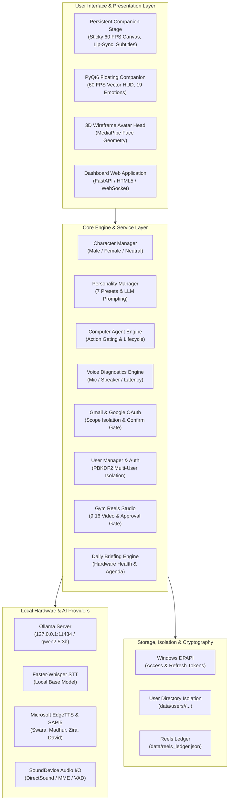

# J.A.R.V.I.S. MARK LVI — ARCHITECTURE & TECHNICAL SPECIFICATION



---

## 1. Architectural Principles

### A. Modular Decoupling
Every core module (`character_manager.py`, `computer_agent.py`, `gmail_manager.py`, `voice_diagnostics.py`, `personality_manager.py`) operates as an independent, testable service with a singleton export pattern and clear dataclass contracts.

### B. Defense-in-Depth Security
1. **Network Layer:** Dashboard binds to `127.0.0.1` by default. When LAN mode is explicitly enabled, it filters clients by true TCP peer address (`scope["client"]`), rejecting non-private subnets, and blocks all administrative routes via `_RESTRICTED_LAN_PREFIXES`.
2. **Cryptographic Layer:** Windows DPAPI provides machine-and-user-bound encryption for OAuth tokens, preventing token exfiltration across user accounts or machines.
3. **Execution Gate Layer:** Destructive and sensitive actions (file deletion, process termination, email sending, social media publishing) require explicit, verified human authorization (`CONFIRM` token) enforced by `ComputerAgent` and `ReelApprovalManager`.

### C. Zero Proprietary Dependencies
All graphics, vector animations, facial expressions, and HUD elements are built using clean-room Python and standard web technologies (PyQt6 QPainter, HTML5 Canvas, SVG), ensuring 100% legal distribution rights.

---

## 2. Directory Layout & Key File Map

```
D:\JARVIS-AI\mark_lvi_core\
├── config/
│   ├── api_keys.json              # System configuration & preferences (Protected)
│   └── smtp_config.json           # Optional SMTP configuration
├── core/
│   ├── avatar.py                  # Holographic wireframe head
│   ├── character_manager.py       # 19 emotions & customization engine (Swara default)
│   ├── computer_agent.py          # Action gating, audit logging & execution engine
│   ├── crypto_storage.py          # Windows DPAPI encryption
│   ├── daily_briefing.py          # Proactive morning/evening briefings
│   ├── floating_companion.py      # PyQt6 floating widget
│   ├── gmail_manager.py           # Google OAuth & Gmail companion
│   ├── gym_reels_studio.py        # Vertical reels video generation
│   ├── personality_manager.py     # 7 personality presets & prompt injector
│   ├── stt.py                     # Faster-Whisper speech-to-text
│   ├── tts.py                     # Multi-voice text-to-speech
│   ├── user_manager.py            # Multi-user isolation & PBKDF2 auth
│   └── voice_diagnostics.py       # Voice pipeline health verification
├── dashboard/
│   ├── server.py                  # FastAPI HTTPS/WSS dashboard server (Swara TTS & SAPI5 fallback)
│   └── static/
│       ├── app.html               # Web companion interface & Persistent Stage
│       ├── login.html             # Secure login interface
│       └── jarvis_design_tokens.css # Stonic-inspired design tokens
├── data/
│   ├── reels_ledger.json          # Historical content ledger (74 entries)
│   ├── instagram_accounts.json    # Connected social accounts
│   ├── memory.json                # Long-term semantic facts
│   └── users/                     # Multi-user isolated data folders
├── installer/
│   ├── build_installer.py         # Inno Setup 6 build script
│   ├── stop_jarvis.py             # Verified-PID process termination
│   └── uninstall_jarvis.py        # Clean uninstaller with data preservation
├── tests/                         # 136 automated unittest cases (inclusive of stage & LAN tests)
└── release/                       # Distribution installer & portable ZIP (149 total unique tests)
```
