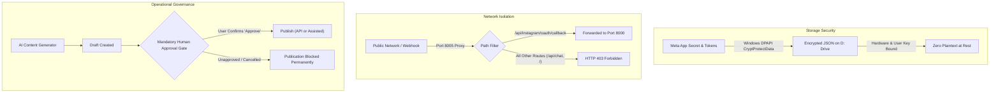

# J.A.R.V.I.S. Instagram Reels Automation — Security & Isolation Audit

**Project Root:** `D:\JARVIS-AI\mark_lvi_core`  
**Security Classification:** Highly Confidential / Local Hardened  
**Audit Scope:** Credential storage, cryptographic encryption, network isolation, approval gates & data sovereignty.

---

## 1. Security Architecture Summary

The J.A.R.V.I.S. Reels Automation module implements multi-tiered defense-in-depth to prevent credential leaks, unintended publications, unauthorized access, and cross-account contamination.

---

## 2. Cryptographic Credential Protection (Windows DPAPI)

1. **At-Rest Encryption:**
   - The Meta App Secret is stored encrypted in `config/api_keys.json` under `meta_app.app_secret`.
   - All OAuth access tokens are encrypted using Windows Data Protection API (`win32crypt.CryptProtectData`) prior to persisting into `data/instagram_accounts.json`.
   - DPAPI utilizes symmetric encryption keys tied to the machine TPM and Windows user logon credentials. Even if the project directory is cloned or accessed by another OS user, the ciphertext cannot be decrypted.
2. **In-Memory Resolution & Ephemeral Lifecycle:**
   - Decryption via `win32crypt.CryptUnprotectData` occurs on-the-fly strictly inside private method `_resolve_token()` when signing requests to `graph.facebook.com`.
   - Decrypted credentials never persist in intermediate variables, global scopes, or cache files.
3. **Log & Console Redaction:**
   - All logging, REST API responses, and exception handlers pass strings through `mask_token()` and `mask_secret()`. Tokens are rendered as `EAA...***[len 43]` or `***MASKED***`.

---

## 3. Reverse Proxy & Network Attack Surface

1. **Callback-Only Route Filtering:**
   - The hardened reverse proxy listening on `127.0.0.1:8005` exposes only the single path:
     `GET /api/instagram/oauth/callback`
   - Every other route (`/`, `/api/chat`, `/api/reels`, `/api/system`, etc.) is immediately rejected with `HTTP 403 Forbidden` and logged with the client IP.
2. **Dashboard Port 8000 Isolation:**
   - Port 8000 is never exposed directly through tunnels or external routers.
   - External services (like Meta OAuth redirect) can only interact with port 8000 through the strictly filtered proxy on port 8005.
3. **CSRF State Parameter Protection:**
   - Every initiated OAuth transaction generates a cryptographically secure 32-byte pseudo-random hexadecimal token (`secrets.token_hex(32)`).
   - This state token is verified on callback arrival. Any callback missing the state or providing an expired/mismatched state is rejected immediately with `HTTP 400 Bad Request`.

---

## 4. Human Approval Gate & Autonomous Containment

1. **Zero Unapproved Publications:**
   - The system architecture enforces a strict state machine:
     `draft` ➔ `waiting_for_approval` ➔ `approved` ➔ `published` / `published_assisted`.
   - `core/instagram_manager.py` explicitly rejects publication calls on any Reel whose status is not `approved`.
   - Automated schedulers, cron jobs, or AI prompts cannot publish without an explicit approval call initiated by the user via the dashboard or authenticated voice trigger.
2. **Target Account Integrity & Quarantine:**
   - All publication workflows verify that the target account is strictly `@mentos_life_gym` with ID `17841458094701596`.
   - Legacy drafts associated with mismatched accounts (`17841400011223344` or `@fatih_personal`) have their publishing controls permanently disabled in both the API and UI (`target_mismatch: true`). Media files are preserved locally for reference but cannot be posted.

---

## 5. Data Sovereignty & Drive Isolation

1. **Strict D: Drive Containment:**
   - All source code, virtual environments, SQLite databases, generated video files, audio tracks, and cover thumbnails reside strictly inside `D:\JARVIS-AI\mark_lvi_core\`.
   - Code-level assertions verify that `get_base_dir().drive.upper() == "D:"`.
   - Zero files, cache entries, or processes utilize the `C:` drive.
2. **No Cloud Render Dependencies:**
   - Video synthesis, subtitle rendering, waveform generation, and voiceover audio mixing execute entirely on local hardware using PyAV, Pillow, and SAPI5.
   - User content, scripts, and drafts are never transmitted to third-party video generation clouds.
