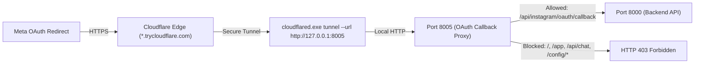

# J.A.R.V.I.S. Mark LVI Core — Free Cloudflare Quick Tunnel Guide & Verification

**Executable Path:** `D:\JARVIS-AI\tools\cloudflared.exe` (Version 2026.10.7)  
**Target Local Service:** `http://127.0.0.1:8005` (Hardened Callback Proxy ONLY)  
**Canonical Callback Path:** `/api/instagram/oauth/callback`  
**Temporary Hostname Format:** `https://<random-subdomain>.trycloudflare.com`  

---

## 1. Security Architecture & Ingress Rules



### Critical Rules
1. **Port 8000 is NEVER exposed:** The Cloudflare tunnel points strictly to `http://127.0.0.1:8005`. Port 8000 remains strictly internal.
2. **Strict Callback Allowlist:** The reverse proxy permits only `/api/instagram/oauth/callback`. All other routes return HTTP 403 Forbidden with header `X-Proxy-Security: JARVIS-Strict-Callback-Only`.
3. **HTTP Method Hardening:** Proxy rejects `OPTIONS`, `PUT`, `DELETE` with HTTP 405 Method Not Allowed.
4. **No Silent Startup:** Public tunnels are never launched silently in the background.

---

## 2. Stale Tunnel Detection & Lifecycle Management

- **Automatic Stale Detection:** [`check_redirect_uri_status()`](file:///D:/JARVIS-AI/mark_lvi_core/core/meta_oauth.py) verifies whether `cloudflared.exe` is actively running via `tasklist`. If the process has exited or proxy port 8005 is offline, it returns `STALE_QUICK_TUNNEL` and flags `is_stale: True`.
- **Safe State Updates:** `data/active_tunnel.json` tracks tunnel state (`ACTIVE`, `INACTIVE`, `EXPIRED`) and records the process PID and timestamp.

---

## 3. Controlled Manual Launch Procedure

When the administrator is ready to conduct a live Meta OAuth test using a free Quick Tunnel:

### Step 1: Ensure Backend and Proxy are Running
If J.A.R.V.I.S. (`main.py`) is already running, ports 8000 and 8005 are active.  
If running manually in standalone mode:
```powershell
# Terminal 1: Backend
& "D:\JARVIS-AI\.venv-jarvis\Scripts\python.exe" -m dashboard.server

# Terminal 2: Hardened Callback Proxy
& "D:\JARVIS-AI\.venv-jarvis\Scripts\python.exe" -m tools.oauth_callback_proxy 8005
```

### Step 2: Start the Quick Tunnel
```powershell
# Terminal 3: Launch Quick Tunnel pointing strictly to port 8005
& "D:\JARVIS-AI\tools\cloudflared.exe" tunnel --url http://127.0.0.1:8005 --no-autoupdate
```
*Note the generated trycloudflare URL in console output, e.g.:*  
`https://sample-name.trycloudflare.com`

### Step 3: Register Temporary Domain in Meta Developer Console
Go to [Meta Developer Dashboard](https://developers.facebook.com/apps/1462879891932217/):
1. **App Settings -> Basic -> App Domains:** Add `trycloudflare.com` (or exact subdomain). Click **Save Changes**.
2. **Facebook Login for Business -> Settings -> Valid OAuth Redirect URIs:** Add  
   `https://sample-name.trycloudflare.com/api/instagram/oauth/callback`. Click **Save Changes**.

### Step 4: Configure Local J.A.R.V.I.S. & Launch Login
```powershell
& "D:\JARVIS-AI\.venv-jarvis\Scripts\python.exe" -c "from core.meta_oauth import meta_oauth; meta_oauth.configure_quick_tunnel_callback('sample-name.trycloudflare.com', confirm=True)"
& "D:\JARVIS-AI\.venv-jarvis\Scripts\python.exe" -m tools.launch_meta_login
```
