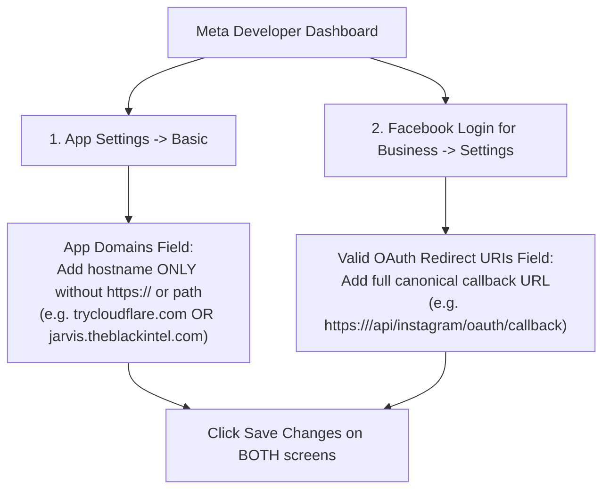

# J.A.R.V.I.S. Mark LVI Core — Meta OAuth Architecture & Finalization

**Target Meta App:** `JARVIS Reels Manager`  
**Meta App ID:** `1462879891932217`  
**Configuration ID:** `4274466502813863`  
**Graph API Version:** `v26.0`  
**Target Account:** `@mentos_life_gym` (`17841458094701596`)  
**Facebook Page ID:** `100998877665544`  
**Status:** **`WAITING FOR ADMIN`**  

---

## 1. OAuth Security & Architecture Verification

| Requirement | Implementation Details | Verified Status |
| :--- | :--- | :---: |
| **App ID & Config ID** | `DEFAULT_APP_ID = "1462879891932217"`, `config_id = "4274466502813863"`. | **VERIFIED** |
| **Unified Login Enforcement** | Enforces `config_id` in authorization dialog; rejects manual `scope` parameter. | **VERIFIED** |
| **CSRF Nonce Protection** | 32-byte URL-safe cryptographic nonce (`secrets.token_urlsafe(32)`), 600s TTL. | **VERIFIED** |
| **Single-Use State Cache** | State is popped from cache immediately upon validation; replay attacks blocked. | **VERIFIED** |
| **Callback Request Validation** | Validates `code`, `state`, handles Meta error parameters (`error_description`). | **VERIFIED** |
| **Secure Token Exchange** | Code -> short-lived user token -> 60-day long-lived token via Graph API. | **VERIFIED** |
| **DPAPI Encryption at Rest** | Tokens encrypted via Windows DPAPI (`dpapi:v1:`). Zero plaintext on disk. | **VERIFIED** |
| **Secret Redaction** | App Secret and authorization tokens scrubbed from logs and exception messages. | **VERIFIED** |
| **Account Discovery** | Queries `/me/accounts` -> inspects `instagram_business_account` -> binds to target. | **VERIFIED** |
| **Live OAuth Status** | External Meta grant pending administrator browser authentication. | **WAITING FOR ADMIN** |

---

## 2. Meta Developer Console Configuration Guide

To avoid the Meta error: `"The domain of this URL isn't included in the app's domains"`:

---

## 3. Required Permissions Bundled in Config ID `4274466502813863`

1. `instagram_basic`: Reads profile information and verifies `@mentos_life_gym` (ID: `17841458094701596`).
2. `instagram_content_publish`: Allows container creation and publishing for Reels.
3. `pages_show_list`: Discovers linked Facebook Page `100998877665544`.
4. `instagram_manage_insights`: Allows post performance tracking and metrics inspection.
