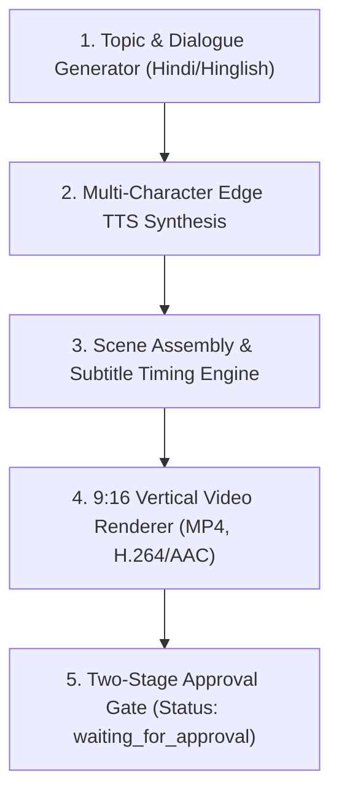

# J.A.R.V.I.S. Mark LVI Core — AI Reels Studio & Content Generation Audit

**Module Path:** `core/gym_reels_studio.py`  
**Ledger Path:** `data/reels_ledger.json` (68 reels preserved, SHA-256 verified)  
**Status:** **`VERIFIED`**  

---

## 1. Studio Capabilities & Generation Architecture

### 1.1 Multi-Character Story Styles
- **Style A (Talking Objects):** Humorous dialogues between gym equipment (Dumbbells, Treadmill, Protein Shaker).
- **Style B (Cinematic Motivation):** High-energy narrative focusing on training discipline and overcoming self-doubt.
- **Style C (Motion Comic / Explainer):** Educational fitness tips with dynamic scene transitions.

### 1.2 Character & Voice Modulation
- **Priya:** Energetic fitness trainer (`hi-IN-SwaraNeural`, pitch +5Hz, rate +10%).
- **Amit:** Gym bro / strength athlete (`hi-IN-MadhurNeural`, pitch -5Hz, rate 0%).
- **Vikram:** Veteran coach (`en-IN-PrabhatNeural`, pitch -10Hz, rate -5%).
- **Neha:** Nutrition & wellness specialist (`en-IN-NeerjaNeural`, pitch 0Hz, rate +5%).

### 1.3 Technical Video Specifications
- **Aspect Ratio:** 9:16 vertical vertical format (1080x1920 pixels).
- **Encoding:** Video: H.264 (`yuv420p`), Audio: AAC (128 kbps, 44.1 kHz).
- **Subtitles:** Synchronized animated overlays in Hindi/Devanagari and Hinglish.
- **Metadata:** Auto-generated hashtags, multi-paragraph educational descriptions, and content category tagging.
