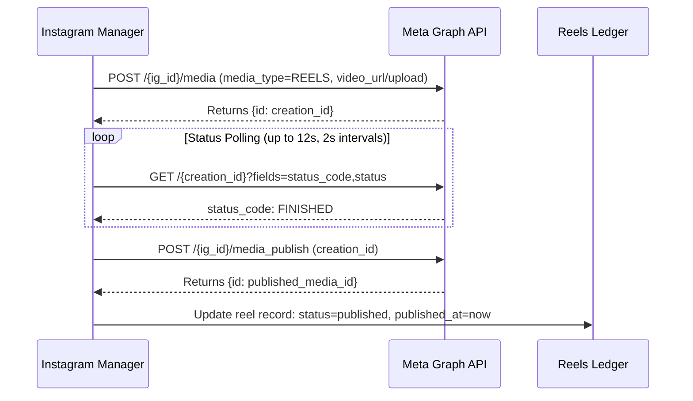

# J.A.R.V.I.S. Mark LVI Core — Reels Upload Pipeline & Safeguards Audit

**Module Path:** `core/instagram_manager.py`  
**Ledger Integrity:** 68 reels byte-for-byte preserved  
**Status:** **`VERIFIED`** (Upload Safeguards Active | Publishing Locked)  

---

## 1. Two-Step Media Container Publishing with Asynchronous Polling

### Key Safeguards Verified
1. **Container Status Polling:** `publish_reel()` polls `GET /{creation_id}?fields=status_code` up to 12s until `FINISHED`. Resolves Meta race condition code 9007 / 2207027.
2. **Timeout Reconciliation:** If a network timeout occurs during container creation or publication, `publish_reel()` catches `TimeoutError`, marks status as `upload_status_unknown`, and immediately halts automated retry loops.
3. **SHA-256 Deduplication:** Computes 64KB chunked hash of rendered MP4 and 16-hex content hash (`{topic}:{title}:{user}`). Blocks duplicate publications.
4. **Approval Gate Separation:** Idea approval is distinct from publication approval. Unapproved reels return `can_publish: False`.
5. **Approval Invalidation:** Calling `edit_reel()` on an approved reel automatically reverts status to `waiting_for_approval` and clears `approved_at`.
6. **Asia/Kolkata (IST) Scheduling:** Evaluates slots at 08:00 IST and 19:00 IST. Unapproved reels at slot time trigger `MISSED_APPROVAL` status and are prevented from publishing.
