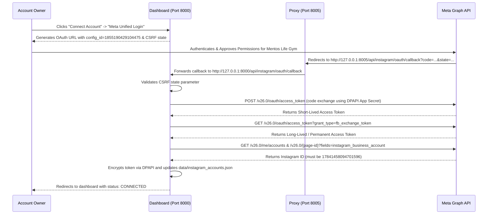

# Meta OAuth & Facebook Login for Business Setup

**Project Root:** `D:\JARVIS-AI\mark_lvi_core`  
**Target Instagram Account:** `@mentos_life_gym`  
**Authoritative Instagram Account ID:** `17841458094701596`  
**Meta App Name:** `JARVIS Reels Manager`  
**Meta App ID:** `2420740248667467`  
**Business Portfolio:** `Mentos Life Gym`  
**Configuration ID:** `1855190429104475`  
**Redirect URI:** `http://localhost:8000/api/instagram/oauth/callback`

---

## 1. Architecture Overview

Meta's modern API authentication for Instagram Business and Creator accounts requires **Facebook Login for Business**. Legacy OAuth implementations that pass individual `scope` query parameters (e.g., `scope=instagram_basic,instagram_content_publish`) are deprecated and rejected by Meta with `OAuthException: Invalid Scopes` when using Business Configurations.

In J.A.R.V.I.S.:
1. Authorization requests specify `config_id=1855190429104475`.
2. Meta looks up the exact permissions, data assets, and System User policies pre-configured under Configuration ID `1855190429104475`.
3. The authorization URL strictly excludes raw `scope` parameters to prevent permission collision errors.
4. The local callback endpoint `/api/instagram/oauth/callback` exchanges the returned authorization code for a short-lived token, subsequently exchanges it for a 60-day or permanent System User token, and verifies that the retrieved Instagram Account ID matches `17841458094701596`.

---

## 2. Configured Meta Permissions

The Business Configuration `1855190429104475` bundles the following essential Instagram Graph API capabilities:

| Permission Name | Meta Scope Description | Purpose in J.A.R.V.I.S. |
| :--- | :--- | :--- |
| `instagram_basic` | Read basic Instagram account metadata | Resolves account ID, username, and profile picture |
| `instagram_content_publish` | Create and publish Reels and media | Creates Reels upload containers and triggers publication |
| `instagram_manage_comments` | Read and moderate comments | Auto-replies to user comments on published Reels |
| `instagram_manage_insights` | Access metrics and analytics | Tracks Reel views, reach, impressions, and engagement |
| `pages_show_list` | Access linked Facebook Pages | Discovers the Page linked to the Instagram Business Account |
| `pages_read_engagement` | Read Page engagement | Ensures API container upload compliance |

---

## 3. Cryptographic Secret Management (Windows DPAPI)

In accordance with institutional security guidelines, **zero plaintext API keys or access tokens are stored in the codebase**.

### Windows Data Protection API (DPAPI)
- **App Secret Encryption:** The Meta App Secret is encrypted via Windows DPAPI (`win32crypt.CryptProtectData`) and saved into `config/api_keys.json` under `meta_app.app_secret`.
- **Token Encryption:** Retrieved access tokens are encrypted via Windows DPAPI before being persisted to `data/instagram_accounts.json`.
- **Hardware & User Binding:** DPAPI encrypts data using a cryptographic key derived from the Windows User logon credentials and machine TPM. Even if the JSON configuration files are copied to an external system, they cannot be decrypted without the machine and user private keys.
- **In-Memory Resolution:** `core/meta_oauth.py` decrypts credentials on-the-fly inside memory only when constructing authorized HTTP headers (`Authorization: Bearer <token>`). Tokens are masked in all console logs, UI payloads, and serialized JSON files (`mask_token()`).

---

## 4. End-to-End OAuth Callback Flow

---

## 5. Security & Isolation Controls

1. **Callback-Only Reverse Proxy (Port 8005):**
   - The proxy strictly matches path prefix `/api/instagram/oauth/callback`.
   - All other routes (`/`, `/api/chat`, `/api/tasks`, `/api/system`, etc.) return immediate `HTTP 403 Forbidden`.
   - Public exposure of internal J.A.R.V.I.S. administrative routes is impossible.
2. **Account Locking:**
   - Any token returned whose Instagram Account ID does not equal `17841458094701596` is rejected with `IDENTITY_MISMATCH` and quarantined.
