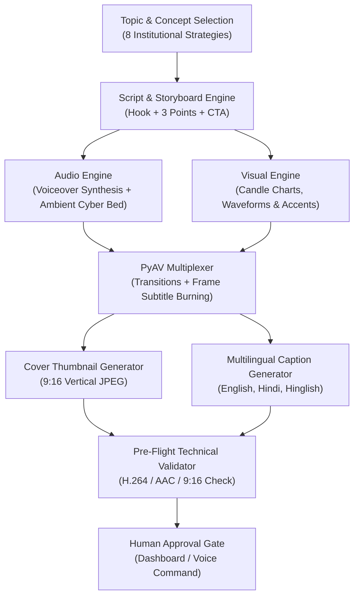

# J.A.R.V.I.S. AI Trading Reels Generation Guide

**Project Root:** `D:\JARVIS-AI\mark_lvi_core`  
**Target Account:** `@mentos_life_gym` (`17841458094701596`)  
**Pipeline Framework:** Native PyAV + Pillow + pyttsx3/SAPI5

---

## 1. End-to-End Generation Workflow

The J.A.R.V.I.S. Reels synthesis engine converts educational financial trading topics into fully produced vertical 9:16 video assets, accompanying cover thumbnails, and multilingual captions without requiring cloud GPU render farms or paid APIs.



---

## 2. Institutional Trading Topics & Script Structure

Every Reel adheres to financial education standards and includes a mandatory compliance disclaimer.

### Built-in Educational Topics
1. **The 1% Risk Rule:** Never risking more than 1% of total capital on a single execution.
2. **Risk-to-Reward Asymmetry:** Demonstrating mathematically how a 40% win rate generates profits with a 1:3 ratio.
3. **Stop Loss Execution:** Invalidation boundaries, discipline, and avoiding backward-moving stops.
4. **Dollar Cost Averaging (DCA):** Systematic time-based accumulation versus erratic market timing.
5. **Bullish Engulfing Structures:** Institutional support demand zones and volume confirmation.
6. **Position Sizing Formula:** Capital × Risk % ÷ Distance to Stop Loss.
7. **Conquering FOMO:** Avoiding retail euphoria top-ticking and waiting for structured pullbacks.
8. **3-Pillar Confluence Checklist:** Structural support, candlestick confirmation, and asymmetric reward.

### 4-Scene Storyboard Breakdown
Each generated Reel is partitioned into 4 distinct scenes:
- **Scene 1 (Hook) [0.0s - 3.5s]:** High-impact contrarian question or statistic with rapid text entry.
- **Scene 2 (Core Lesson) [3.5s - 9.0s]:** Visual candlestick chart / indicator demonstration and mathematical rule.
- **Scene 3 (Execution Framework) [9.0s - 13.5s]:** Step-by-step checklist to apply the lesson.
- **Scene 4 (Call to Action & Disclaimer) [13.5s - 16.5s]:** `@mentos_life_gym` branding, CTA, and educational disclaimer.

---

## 3. Video Synthesis & Transitions

Videos are rendered frame-by-frame via `av` (PyAV) with zero external CLI dependencies:
- **Resolution:** 1080 × 1920 (or 720 × 1280) vertical format (9:16 aspect ratio).
- **Video Codec:** `h264` (High Profile, Level 4.2).
- **Frame Rate:** 30 frames per second.
- **Color Grading:** Deep Cyber Dark Palette (`#0B0F19` background, `#00F0FF` cyan accents, `#22C55E` green candles, `#EF4444` red candles).
- **Transitions:**
  - `crossfade`: Smooth linear alpha blend between consecutive scene backgrounds.
  - `cyber_swipe`: Horizontal luminous scanline transition across scene boundaries.
  - `fade_black`: Cinematic exponential dip-to-black transition.

---

## 4. Subtitles & Audio Architecture

1. **Voiceover Synthesis:** Synthesized via Windows SAPI5 / pyttsx3 (`voice_id="female"` or `"male"`), generated at 175 words per minute.
2. **Background Audio Bed:** Looped ambient audio track normalized to -18 dB to ensure crisp voiceover prominence (`ambient_cyber`, `lofi_synth`, `clean_voice`).
3. **Burned Subtitles:** Synchronized subtitle text rendered directly onto the video frames with contrasting dark pill backgrounds, guaranteeing legibility even when viewed on mobile screens with muted audio.

---

## 5. Multilingual Captions & Cover Generation

### Cover Art Generation (`{id}_cover.jpg`)
A standalone 9:16 vertical JPEG is generated for each Reel:
- Dark gradient with neon cyan/magenta border glow.
- Central title badge with bold uppercase typography.
- Subtitle badge highlighting the core takeaway.
- Official branding watermark: `@mentos_life_gym`.

### Multilingual Captions
Every Reel generates 3 linguistic variations:
1. **English:** Structured with Hook, Key Points, Checklist, CTA, and Hashtags.
2. **Hindi (Devanagari):** Native script translation ("ट्रेडिंग में 90% लोग पैसा क्यों गंवाते हैं?...").
3. **Hinglish (Roman Hindi):** Conversational Romanized Hindi ("Agar aap 10k dollar account par trade kar rahe ho toh...").

---

## 6. Regeneration & Editing Workflow

If a creator desires a different aesthetic or script direction:
- **UI:** Click **🔄 Regenerate** on any Reel card in the dashboard.
- **API:** Send `POST /api/reels/{reel_id}/regenerate` with optional parameters:
  ```json
  {
    "transition_type": "cyber_swipe",
    "audio_track": "lofi_synth",
    "voice_id": "male",
    "subtitles_enabled": true
  }
  ```
- **Voice / Chat Command:** Say `"is Reel ko regenerate karo"` to trigger instant re-synthesis.
