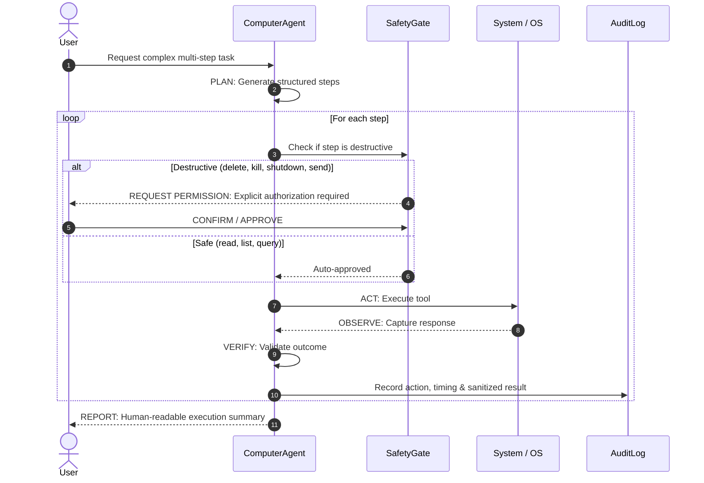

# J.A.R.V.I.S. Mark LVI — Technical Architecture & Security Model

This document outlines the architectural design, isolation mechanisms, and data flows of J.A.R.V.I.S. Mark LVI Core.

---

## 1. High-Level Subsystem Architecture

```mermaid
flowchart TD
    UserAudio["Microphone Input (16 kHz DirectSound)"] --> VAD["WebRTC VAD & Noise Filter"]
    VAD --> STT["Faster-Whisper STT (Local CPU)"]
    STT --> Brain["J.A.R.V.I.S. Core Brain (main.py)"]
    
    subgraph Client UIs
        DesktopHUD["PyQt6 Desktop HUD (ui.py)"] <--> Brain
        Companion["Floating Companion Widget (core/floating_companion.py)"] <--> Brain
        MobileWeb["Android Companion (Browser / PWA)"] <-->|AES-256-GCM (Port 8000)| WebBackend["FastAPI Backend (dashboard/server.py)"]
        WebBackend <--> Brain
    end

    subgraph Intelligence & Processing
        Brain --> LLM["Local Ollama / Qwen2.5:3b (Port 11434)"]
        Brain --> Memory["Memory Manager (memory/memory_manager.py)"]
        Brain --> RAG["Local Knowledge Base (core/knowledge_manager.py)"]
        Brain --> Briefing["Daily Briefing Engine (core/daily_briefing.py)"]
        Brain --> Agent["Computer Agent Engine (core/computer_agent.py)"]
    end

    subgraph Audio Output
        Brain --> TTS["TTS Dispatcher (Windows SAPI / Piper Neural / Hindi)"]
        TTS --> AudioOut["Speaker Output (24 kHz MME)"]
    end

    subgraph Network Isolation Guardrail
        Internet["External Public Ingress"] --> Tunnel["Cloudflare Named Tunnel (jarvis.theblackintel.com)"]
        Tunnel -->|Forward Allowed Route ONLY| Proxy["Hardened Reverse Proxy (Port 8005)"]
        Proxy -->|Allowed: /api/instagram/oauth/callback ONLY| WebBackend
        Proxy -->|Blocked: /, /app, /api/*| Deny["403 Forbidden"]
    end
```

---

## 2. Network Isolation Architecture (Port 8000 vs Port 8005)

A cornerstone of J.A.R.V.I.S. security is **absolute backend isolation**:
- **Port 8000 (Backend API, WebSocket, Dashboard):**
  - Binds strictly to `127.0.0.1`.
  - Is **NEVER** exposed directly to public tunnels or external networks.
  - Serves local desktop UI and paired local network devices.
- **Port 8005 (Hardened Callback Proxy):**
  - Managed by `tools/oauth_callback_proxy.py`.
  - Ingress allowlist permits **ONLY** `^/api/instagram/oauth/callback/?$`.
  - Default-Deny: Rejects `/`, `/app`, `/api/chat`, `/api/system/status`, `/config/api_keys.json` with `HTTP 403 Forbidden` (`X-Proxy-Security: JARVIS-Strict-Callback-Only`).
  - Unsupported methods (`PUT`, `DELETE`) are immediately blocked (`403`); non-GET methods return `405 Method Not Allowed`.

---

## 3. Computer Agent Lifecycle & Safety Invariants



---

## 4. Cryptographic Storage & DPAPI Model

- **Tokens at Rest:** OAuth access tokens in `data/instagram_accounts.json` are encrypted using Windows Data Protection API (`dpapi:v1:...`) tied to the Windows user account.
- **Mobile Pairing:** Mobile pairing sessions derive an AES-256-GCM symmetric key using PBKDF2 with 100,000 iterations over the high-entropy pairing code.
- **Zero Log Leaks:** All exceptions, logging hooks, and audit writers pass through regex credential scrubbers preventing accidental token exposure.
