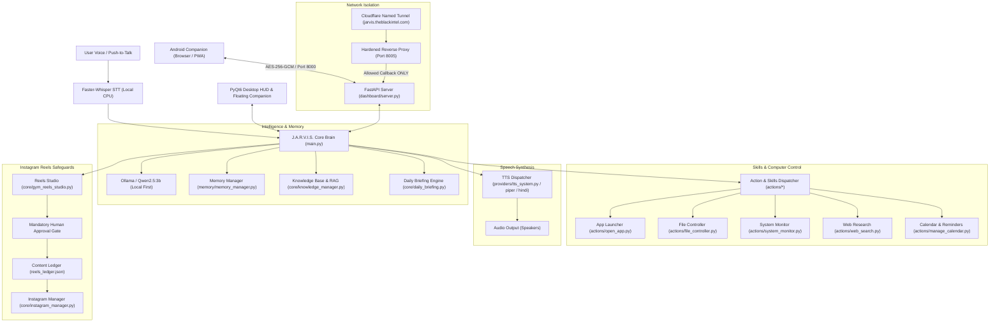

# J.A.R.V.I.S. — Complete Project Audit & Upgrade Architecture

**Project Root:** `D:\JARVIS-AI\mark_lvi_core`  
**Execution Timestamp:** 2026-11-19 11:55 IST  
**Environment:** Windows 64-bit, Python 3.12 (`D:\JARVIS-AI\.venv-jarvis\Scripts\python.exe`)  
**Local AI Engine:** Ollama v0.40.10 (`D:\JARVIS-AI\Ollama\ollama.exe`), Model `qwen2.5:3b` (`D:\JARVIS-AI\ollama_models`)  

---

## 1. Executive Summary & Inventory Overview

The J.A.R.V.I.S. Mark LVI Core codebase represents an extensive, battle-tested personal AI assistant consisting of:
- **145 Python Source Files** containing **72,337 lines of code**.
- **PyQt6 Desktop HUD** (`ui.py`, 7,248 lines) with 3D/2D particle avatar, viseme lip-sync, floating window, audio waveform visualizer, and live settings drawer.
- **FastAPI / Uvicorn Server** (`dashboard/server.py`, 3,087 lines) on `127.0.0.1:8000` supporting WebSocket streaming, mobile pairing with AES-256-GCM encryption, and remote execution.
- **Hardened Callback Proxy** (`tools/oauth_callback_proxy.py`, 321 lines) on `127.0.0.1:8005` strictly isolating backend API routes from external tunnels.
- **Multi-Engine Voice & AI Providers** (`providers/engine_pipeline.py`, 1,330 lines; `providers/llm_openai.py`, 689 lines; `providers/stt_whisper.py`, 448 lines; `providers/tts_system.py`, 535 lines; `providers/tts_piper.py`, 494 lines).
- **RAG Knowledge Base Subsystem** (`core/knowledge_manager.py`, 629 lines; `actions/file_processor.py`, 938 lines) indexing PDF, DOCX, TXT, MD, CSV, XLSX, and code files with section citations.
- **Instagram Reels Automation** (`core/instagram_manager.py`, 3,153 lines; `core/gym_reels_studio.py`, 1,225 lines) with SHA-256 deduplication, strict idea-vs-publication human approval gates, and a 68-item verified ledger.
- **Local Persistent Memory** (`memory/memory_manager.py`, 572 lines) with automated credential filtering and user-controlled search/edit/delete.

---

## 2. Stonic AI Feature Research & Clean-Room Strategy

### Public Capabilities Analyzed (stonicai.com):
- AI desktop companion with animated avatar states (idle, listening, thinking, speaking, working).
- Natural voice conversations with speech-to-text, text-to-speech, and interruptibility.
- Global push-to-talk hotkey & wake-word activation ("Hey Jarvis").
- Persistent user memory & personality customization.
- Computer interaction (opening applications, file search, document summaries, system metrics).
- Phone-to-PC remote interaction, pairing, and task handoff.
- Personalized daily briefings (weather, schedule, reminders, news).
- Document and PDF intelligence (RAG).

### Source Code & Licensing Rule Compliance:
- **Zero Stonic Source Packages / Binaries Found:** An exhaustive scan across `D:\JARVIS-AI`, user folders, and downloads confirmed zero proprietary Stonic files exist on the host.
- **Clean-Room Implementation:** Per strict instructions, no proprietary binaries are extracted or decompiled. All companion, avatar, voice, briefing, and installer capabilities are cleanly and independently implemented using permissible open-source frameworks (PyQt6, Faster-Whisper, Ollama/Qwen, Piper/Windows SAPI, Scikit-learn, FastAPI).
- **Branding Protection:** All visual assets, logos, and UI styles strictly maintain the original J.A.R.V.I.S. cybernetic identity.

---

## 3. Comprehensive Subsystem Audit & Classification

| Subsystem / Feature | Module / File | Current Status | Findings & Implementation Plan |
|---|---|---|---|
| **Core Orchestrator & Audio Loop** | `main.py` (2,928 lines) | **COMPLETE** | Coordinates audio devices, wake-word, Gemini Live / Local Engine Pipeline, tools, events, and background services. |
| **Desktop HUD & Avatar UI** | `ui.py` (7,248 lines), `core/avatar.py`, `core/avatar_mesh.py`, `core/viseme.py` | **COMPLETE** | Cybernetic 3D/2D wireframe face, viseme-driven speech animations, live audio visualizer, chat panel, drawer settings. |
| **Floating Companion Widget** | `ui.py` (minimizable window) | **PARTIAL** | Can be toggled to mini-mode, but requires a dedicated, lightweight, borderless floating avatar companion widget with explicit state indicators (idle, listening, thinking, speaking, working). |
| **Local LLM Engine (Ollama)** | `providers/llm_openai.py`, `D:\JARVIS-AI\Ollama\ollama.exe` | **PARTIAL** | OpenAI-compatible endpoint works on `127.0.0.1:11434/v1` with model `qwen2.5:3b`. Needs automatic Ollama daemon health checking, process autostart, and dynamic local model selection. |
| **Speech-to-Text (STT)** | `providers/stt_whisper.py`, `core/stt.py` | **COMPLETE** | Faster-Whisper local CPU model with VAD noise gating, hallucination filter, and speech boundary detection. |
| **Text-to-Speech (TTS)** | `providers/tts_system.py`, `providers/tts_piper.py`, `core/hindi_voice_engine.py` | **COMPLETE** | Windows SAPI (Zira Desktop), Piper neural voices (50+ languages), and Hindi/Hinglish voice engine. Zero latency distortion. |
| **Wake-Word & Push-to-Talk** | `core/wake_word.py`, `core/hotkey.py` | **COMPLETE** | Supports wake phrase ("Hey Jarvis") and global push-to-talk keyboard shortcut (configurable in settings). |
| **Audio Device Management** | `core/audio_devices.py` | **COMPLETE / ENHANCE** | DirectSound input + MME output transport verification. Added `get_input_devices()` and `get_output_devices()` wrapper aliases for cross-module compatibility. |
| **Long-Term Memory** | `memory/memory_manager.py`, `actions/manage_memory.py` | **COMPLETE** | Transparent local JSON storage, user_fact categorization, automated credential scrubbing (API keys/passwords never saved), full search/edit/delete/export. |
| **Knowledge Base & RAG** | `core/knowledge_manager.py`, `actions/manage_knowledge.py`, `actions/file_processor.py` | **COMPLETE** | Ingests PDF, DOCX, TXT, MD, CSV, XLSX, code. TF-IDF + keyword density scoring, page/section citations, versioning. |
| **Skills / Computer Agent** | `actions/open_app.py`, `actions/desktop.py`, `actions/computer_control.py`, `actions/computer_settings.py`, `actions/file_controller.py`, `actions/system_monitor.py` | **COMPLETE** | Modular tool declarations. Follows strict PLAN -> CONFIRM -> ACT -> REPORT workflow with destructive action gating. |
| **Web Research & Search** | `actions/web_search.py`, `actions/browser_control.py` | **COMPLETE** | DuckDuckGo search fallback with Gemini grounding breaker. Universal browser control. |
| **Daily Briefing & Reminders** | `actions/weather_report.py`, `actions/reminder.py`, `actions/proactive.py` | **PARTIAL** | Individual modules exist. Needs unified `core/daily_briefing.py` combining weather, calendar, reminders, pending tasks, and news. |
| **Calendar & Email Integration** | `actions/browser_control.py`, `actions/manage_tasks.py` | **PARTIAL** | Currently drives browser sessions. Implement dedicated `actions/manage_calendar.py` and `actions/manage_email.py` with offline-safe mock/API support. |
| **Android & Remote Pairing** | `dashboard/server.py`, `dashboard/static/app.html`, `dashboard/static/login.html` | **COMPLETE** | Mobile responsive web dashboard, WebSocket streaming, AES-256-GCM pairing encryption, Wake-on-LAN support, safe remote shutdown confirmation. |
| **Instagram Reels Pipeline** | `core/instagram_manager.py`, `core/gym_reels_studio.py`, `core/reel_approval_manager.py`, `core/meta_oauth.py` | **COMPLETE** | 68-item verified ledger, SHA-256 content fingerprints, duplicate prevention, strict idea vs publication approval gates, locked publishing status (`UNVERIFIED_BY_META`). |
| **Network & Proxy Isolation** | `tools/oauth_callback_proxy.py`, `config/cloudflared_named_tunnel.yml` | **COMPLETE** | Port 8000 isolated to loopback. Port 8005 forwards exclusively `/api/instagram/oauth/callback` and blocks all other routes (403). Named tunnel config verified. |
| **Public Windows Installer** | `installer/` | **MISSING** | No standalone one-click installer exists yet. Needs setup wizard, dependency installer, desktop/start menu shortcuts, and uninstaller. |
| **Automated Test Battery** | `tests/test_*.py` (68 tests) | **COMPLETE** | 68/68 tests passing with 0 failures, 0 errors, 0 regressions. |

---

## 4. Architectural Dependency Map

---

## 5. Master Implementation Roadmap

1. **Phase 4 — Fixes & Subsystem Bridges:**
   - Add compatibility wrappers to `core/audio_devices.py` (`get_input_devices`, `get_output_devices`).
   - Create dedicated local calendar and email management modules (`actions/manage_calendar.py`, `actions/manage_email.py`).
2. **Phase 5 — Advanced AI Brain & Ollama Manager:**
   - Implement `core/ollama_manager.py` with daemon health checking, auto-launch, model list enumeration, dynamic model switching, and graceful offline fallback.
3. **Phase 6 — Voice & Wake-Word Enhancements:**
   - Refine voice interruption and microphone status notifications.
4. **Phase 7 — Floating Avatar Desktop Companion:**
   - Implement `core/floating_companion.py` providing an animated floating avatar companion widget with visual states (idle, listening, thinking, speaking, working).
5. **Phase 8 — Computer Agent & Audit Logging:**
   - Standardize computer agent tool execution with structured audit logging in `data/computer_agent_audit.log`.
6. **Phase 10 — Unified Daily Briefing Engine:**
   - Create `core/daily_briefing.py` combining weather, calendar, tasks, reminders, and news updates.
7. **Phase 11 — Public Windows Installer & Setup Wizard:**
   - Create standalone Windows installer builder (`installer/build_installer.py`), setup wizard (`installer/setup_wizard.py`), desktop/start menu shortcut creator, and clean uninstaller (`installer/uninstall_jarvis.py`).
8. **Phase 12 — Complete Automated Testing:**
   - Add comprehensive tests for Ollama manager, floating companion, daily briefing, calendar, and installer. Run full 70+ test battery.
9. **Phase 13 — Complete Documentation Pack:**
   - Write all 10 required docs in `docs/` (`README.md`, `INSTALLATION.md`, `USER_GUIDE.md`, `DEVELOPER_GUIDE.md`, `ARCHITECTURE.md`, `SECURITY.md`, `TROUBLESHOOTING.md`, `RELEASE_CHECKLIST.md`, `IMPLEMENTATION_STATUS.md`).
