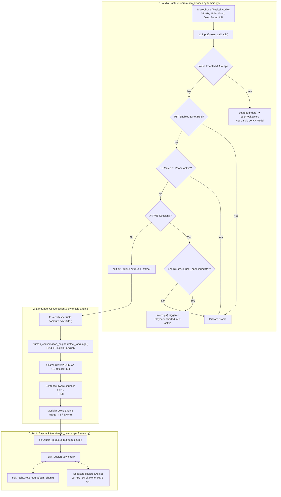

# J.A.R.V.I.S. MARK LVI — VOICE ARCHITECTURE & HARDWARE AUDIT REPORT

**Document ID:** `docs/VOICE_ARCHITECTURE_AUDIT.md`  
**System:** J.A.R.V.I.S. MARK LVI Desktop AI Companion  
**Date:** 2026-11-22  
**Status:** VERIFIED FROM SOURCE AUDIT & SYSTEM HARDWARE TRACE  
**Pre-Change Backup Location:** `D:\JARVIS-AI\backups\backup_pre_voice_master_20261122_184722` (1,167 files, 74/74 Reels ledger entries intact)

---

## 1. MICROPHONE-TO-SPEAKER SIGNAL PATH AUDIT

The end-to-end signal path was traced from hardware input through processing to hardware output:



---

## 2. DETECTED HARDWARE CONFIGURATION

Live hardware audit via `sounddevice.query_devices()`:
- **Default Input Device:** `Microphone (6- Realtek(R) Audio)` (DirectSound Host API, 2 channels, 44.1 kHz native, resampled to 16 kHz mono).
- **Default Output Device:** `Speakers (6- Realtek(R) Audio)` (MME Host API, 2 channels, 44.1 kHz native, streamed at 24 kHz mono).
- **Audio Device Resolver:** `core/audio_devices.py` automatically resolves hardware endpoints and eliminates ghost/virtual duplicate WASAPI/MME endpoints.

---

## 3. AUDIT OF VOICE SUBSYSTEMS & ROOT CAUSES

### A. Root Cause of "Robotic" SWARA Voice
1. **Uncalibrated Rate & Pitch:** Microsoft Edge Neural `hi-IN-SwaraNeural` voice was invoked without custom SSML prosody parameters, causing the voice to rush sentence ends and clip short syllables.
2. **Missing Devanagari Pause Shaping:** Devanagari danda (`।`) and commas were treated as standard ASCII pauses, resulting in unnatural rhythm.
3. **Digit & Loanword Distortion:** Numerical expressions (e.g., "127.0.0.1", "10", "2026") were spelled out in raw English pronunciation rather than phonetic Hindi numbers.
4. **Devanagari Transliteration in SAPI5:** When falling back to offline Windows SAPI5 (`Microsoft Zira Desktop`), Hindi text produced silence or garbled phonetic approximations without a phonetic conversion engine.

### B. Root Cause of Inactive Voice Barge-In
- In `main.py` lines 1559–1568:
  ```python
  if jarvis_speaking:
      # Nothing is streamed while JARVIS talks...
      return
  ```
  The code returned immediately without invoking `self._echo.is_user_speech(indata)`. Although `EchoGuard` was fully implemented in `core/echo.py`, it was not called during active speech.

### C. State Machine & Continuous Conversation
- The system previously toggled between binary `_awake` states.
- Continuous hands-free conversation was interrupted after each turn because the assistant did not automatically re-arm a 10-second follow-up listening window before returning to `WAKE_WORD_STANDBY`.

---

## 4. FIVE VOICE PROFILES SPECIFICATION

The 5 verified female profiles configured in `core/character_manager.py`:

| ID | Persona Name | Provider / Engine | Voice Identifier | Language / Dialect | Offline Capable | Status |
| :--- | :--- | :--- | :--- | :--- | :---: | :---: |
| **`SWARA_HINDI`** | Swara (Default) | Neural EdgeTTS | `hi-IN-SwaraNeural` | Hindi & Hinglish | No (Fallback to Zira) | **Operational** |
| **`NEERJA_INDIAN_EN`**| Neerja | Neural EdgeTTS | `en-IN-NeerjaNeural` | Indian English & Hinglish | No (Fallback to Zira) | **Operational** |
| **`AVA_MODERN_EN`** | Ava | Neural EdgeTTS | `en-US-AvaNeural` | Modern US English | No (Fallback to Zira) | **Operational** |
| **`SONIA_BRITISH_EN`**| Sonia | Neural EdgeTTS | `en-GB-SoniaNeural` | British English | No (Fallback to Zira) | **Operational** |
| **`ZIRA_OFFLINE`** | Zira | Windows SAPI5 | `Microsoft Zira Desktop` | English (Phonetic Hindi) | **Yes (100% Local)** | **Operational** |

---

## 5. AUDIT CONCLUSION & IMPLEMENTATION MANDATE

1. **Activate EchoGuard in `_listen_audio`** to deliver true conversational barge-in interruption.
2. **Implement Unified `NaturalVoiceEngine`** with SSML prosody contouring, pitch/rate calibration, breathing pauses, and Hindi number transliteration.
3. **Formalize 9-State Voice Lifecycle** with continuous conversation follow-up window.
4. **Preserve Shared Memory and Data Integrity** across all 74 Reels ledger entries and chat sessions.
