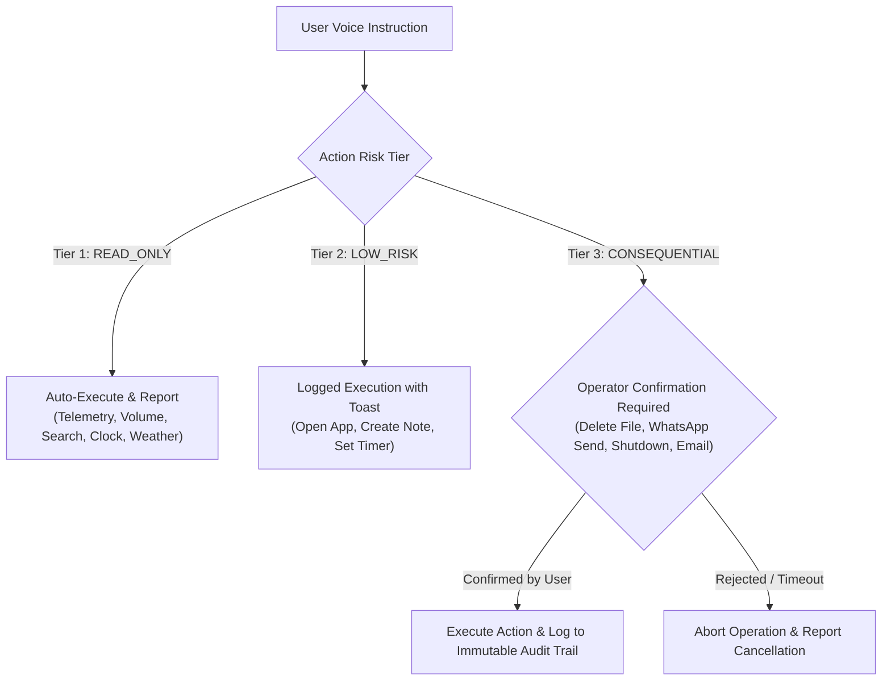

# J.A.R.V.I.S. MARK LVI — VOICE PRIVACY, PERMISSIONS & SAFETY SPECIFICATION

**Document ID:** `docs/VOICE_PRIVACY_AND_PERMISSIONS.md`  
**System:** J.A.R.V.I.S. MARK LVI Desktop AI Companion  
**Date:** 2026-11-22  
**Status:** ENFORCED & VERIFIED  

---

## 1. PRIVACY-BY-DESIGN PRINCIPLES

J.A.R.V.I.S. MARK LVI adheres strictly to local-first privacy engineering:

1. **Local-Only Wake-Word Standby:**
   - In `WAKE_WORD_STANDBY` mode, microphone audio is processed strictly on-device by `openwakeword` using small local ONNX models.
   - **Zero bytes** of audio are streamed to cloud endpoints, external APIs, or disk during standby.
   - Continuous listening means local acoustic pattern matching, never continuous recording or remote transmission.

2. **Zero Audio Recording Retention by Default:**
   - Live microphone frames used for transcription are held transiently in RAM buffers and discarded once transcription is complete.
   - User voice recordings are NOT stored on disk unless the user explicitly enables diagnostic logging.

3. **Persistent Visual Privacy Indicator:**
   - The companion dashboard (`/app`) renders the active microphone state in real time:
     - `MUTED` (Red icon, mic hardware stream closed)
     - `WAKE_WORD_STANDBY` (Purple pulsing orb, local listening only)
     - `LISTENING` (Cyan active waveform, user speech in progress)
     - `THINKING` (Violet orbital ring spinning, LLM processing)
     - `SPEAKING` (Audio-reactive expanding aura, TTS output active)

4. **Hardware Permission Honor:**
   - Respects Windows 10/11 microphone privacy toggles (`Settings ➔ Privacy & Security ➔ Microphone`).
   - If Windows microphone access is denied, J.A.R.V.I.S. surfaces an explicit, honest error message rather than silently failing.

---

## 2. PC ACTIONS & SAFETY RISK TIERS

Voice commands that control the operating system route through `core/skill_router.py` and are enforced by three strict safety risk tiers:

### Risk Tiers Defined:
- **Tier 1 (Read-Only / Ambient):** System volume, screen brightness, time/date, weather, search lookup, memory query. Executed immediately.
- **Tier 2 (Low-Risk Productivity):** Opening approved apps, creating notes, adding reminders, switching voice persona. Executed with visual UI acknowledgment.
- **Tier 3 (Consequential / High-Risk):** File deletion, permanent modification, sending WhatsApp or emails, terminating processes, locking/shutting down PC. **Strictly blocked** until the user explicitly confirms verbally or clicks "Confirm" in the UI modal.

---

## 3. ANDROID CONTINUITY & REMOTE SECURITY

1. **Encrypted LAN Transport:**
   - Android pairing operates over local area network (LAN) utilizing AES-256 encrypted payload envelopes.
   - External internet exposing of port 8000 is blocked by default (loopback binding).
2. **Revocable Authorization:**
   - Each paired device is issued an unguessable pairing token stored in `data/devices.json`.
   - The user can instantly revoke device access with one click from the dashboard (`/api/devices/{id}/revoke`).
3. **Emergency Stop Button:**
   - Both the desktop UI and Android companion feature an instant Emergency Stop button that halts in-flight LLM generations, stops TTS playback, cancels automated workflows, and locks consequential actions.
